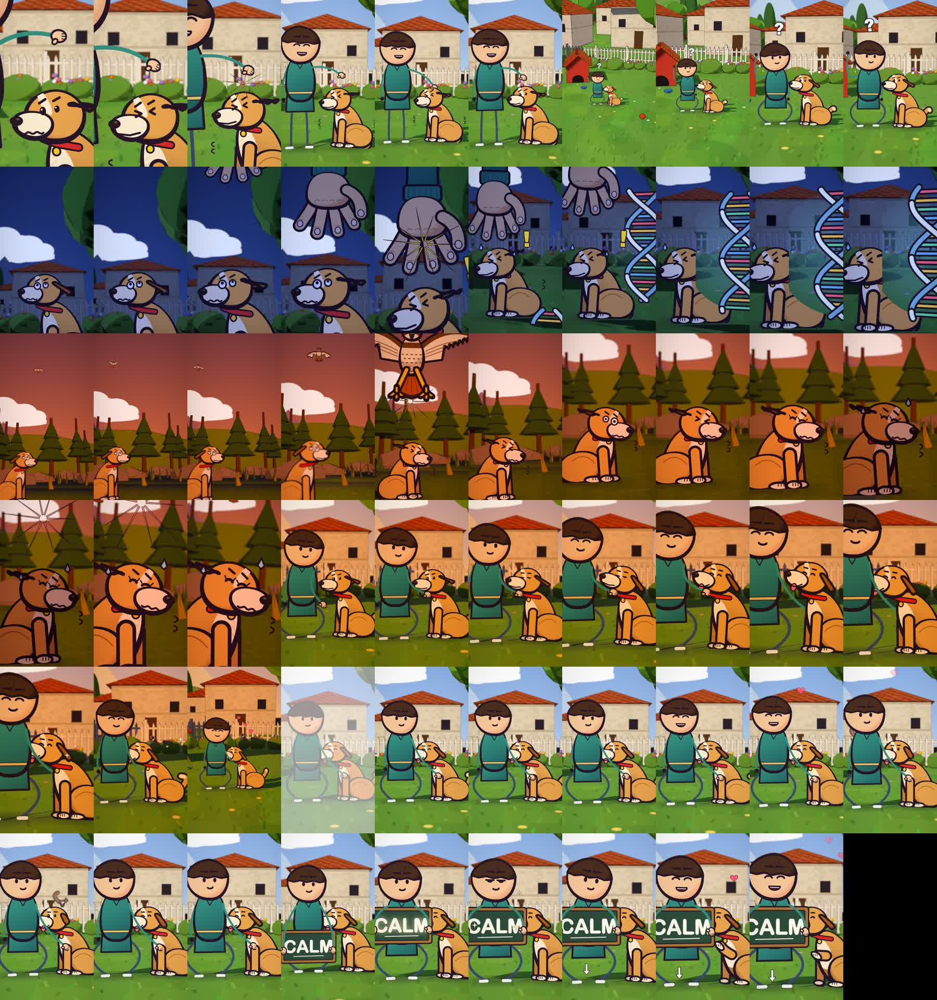

# cartoon-short-kit

Audio in, finished vertical cartoon short out. Flat 2D cartoon characters in an inked, painted 3D world
(three.js in headless Chromium, no GPU needed), timed to your voiceover, with a synthesized music bed and sound effects.

This repo includes a complete worked example, **"Stop Patting Your Dog On The Head"**: a human, a dog, a hawk and a giant
hand explaining why a hand looming over a dog's head feels like a predator's attack. The rest of this page teaches you
how to make a video like it. The finished video is at
[example/dog-head-pat/out/Stop-Patting-Your-Dog.mp4](example/dog-head-pat/out/Stop-Patting-Your-Dog.mp4).



## What's in the repo

| Path | What it is |
|---|---|
| `example/dog-head-pat/` | The dog video: shot plan, characters, world, sound cues, and its own README with the exact build order |
| `example/soldier/` | An earlier example, "The Soldier Who Never Left" |
| `engine/` | The renderer starter files (`main.js`, `paint.js`, `roman.js`, `motion.js`) copied into each new project |
| `tools/` | `setup.sh` (new project), `timing.py`, `render.mjs`, `sheet.py`, `finish.sh` |
| `vendor/toon.ts` | The Pen/face drawing library 
| `SKILL.md` | The instructions Claude follows to go from idea to finished MP4 |

## How the dog video was made (the original prompt)

The video came from this one prompt to Claude Code, run inside this repo:

> can you create a new cartoon short just a few seconds long with a cartoon human and the dog itself, about why you
> should stop patting your dog on their head
>
> "Stop patting your dog on top of their head. The reason is simpler than you think. that looming hand triggers a threat
> flinch that's coded into your dog's DNA. Looming overhead touch mimics a predatory attack, forcing their eyes shut and
> trapping them in fear. instead, stroke gently beneath their chin or side of the chest to unlock true calm."
>
> go into strong detail with the cartoon character and the dog itself, and even create a hawk for the overhead predatory
> attack example - use the cartoon-short-kit skill thats in this repo
>
> `audio_head_touch.mp3` (20 seconds long), then a 7 second long `call_to_action.mp3`

What made it work, so you can copy the recipe:

1. **Give the script as spoken text.** The picture is timed to the voice, so the exact words matter.
2. **Name the visual metaphor you want.** "A hawk for the overhead predatory attack" became the dive shot.
3. **Provide the voiceover as audio** (see below). The video is exactly as long as the audio.
4. **Point Claude at `SKILL.md`.** It lays out the whole process: timing, shot plan, world, cast, motion, sound, render.

## Make your own dog video

### 0. Install the tools

You need Node 22.6 or newer, Python 3 with `numpy` and `Pillow`, ffmpeg, and Playwright with Chromium.

```bash
brew install ffmpeg                       # or your OS's package manager
pip3 install numpy pillow faster-whisper
npm i -g playwright && npx playwright install chromium
```

### 1. Write the script

Write the narration as plain spoken English. Aim for about 3.7 words per second: 20 s is about 75 words, 30 s about
110. Open with a hook, give one clear reason, end with the fix. The dog script has this shape:

1. Hook: "Stop patting your dog on top of their head."
2. The reason, in plain words.
3. The mechanism, with something you can show (a looming hand, a hawk).
4. The fix, with a calm payoff.

### 2. Record the voiceover

Record one steady, warm voice with natural pauses at the end of each sentence, no music, and save it as mp3 or wav.
[ElevenLabs](https://elevenlabs.io) works well (a warm narrator voice, speed about 1.05 to 1.1, stability about 50%).
If you also want a call to action, record it as a second clip. The example joined two clips with ffmpeg:

```bash
ffmpeg -i voice_main.mp3 -i call_to_action.mp3 -filter_complex \
 "[0:a]aresample=48000,aformat=channel_layouts=mono[a];[1:a]aresample=48000,aformat=channel_layouts=mono[b];[a][b]concat=n=2:v=0:a=1" \
 -c:a pcm_s16le voice.wav
```

The audio files are not stored in this repo, so you bring your own.

### 3. Fastest path: let Claude Code do it

Clone the repo, open it in [Claude Code](https://claude.com/claude-code), drop your mp3 files in the folder, and send a
prompt shaped like the one above, ending with "use the SKILL.md in this repo". Claude will create
`example/<your-name>/`, time the shots to your voice, build the scene, render, and mix.

### 4. Manual path: copy the dog example and change it

```bash
cp -r example/dog-head-pat example/my-dog-video
cd example/my-dog-video
```

Put your `voice.wav` (or mp3) in the folder, then follow the numbered build steps in
[example/dog-head-pat/README.md](example/dog-head-pat/README.md). The files you edit, in order:

1. **`transcribe.py`**: run it on your voice file to get word timestamps (`*.words.json`). Frames = seconds x 30.
2. **`web/story.js`**: the shot list. Each shot has a frame range, a light preset, a camera path, depth of field, and
   a pose for every character at every frame. Change the frame numbers to match your words (the header comment shows
   the pattern), then change what happens in each shot.
3. **`audio.py`**: the music sections and the sound-effect cue table (cue times are frames / 30).
4. Render and finish:

```bash
cat web/toonbase.js web/roman.js web/dogcast.js > web/toon.js
python3 audio.py && python3 mix.py voice.wav music.wav sfx.wav
node render.mjs stills/check "2,44,95,140"          # a few test frames first
python3 sheet.py stills/check stills/sheet.jpg 9    # look at the contact sheet
node render.mjs frames "0-<last frame>"             # about 1 second per frame
bash finish.sh "My Dog Video"                       # writes out/My-Dog-Video.mp4
```

Check the contact sheet before the long render. Fix framing problems (characters cut off, hands hidden) while it's cheap.

## Customize the dog and the people

All characters are drawn in code, so you change them by changing numbers.

**The dog** (`web/dogcast.js`, `dogDraw`): change the `DOG` colour table at the top for a different breed or coat
(`fur`, `furD`, `cream`, `ear`, `collar`). Poses are options you pass per frame:

| Option | Effect |
|---|---|
| `eyes` | `dot`, `wide`, `squeeze` (flinch), `shut`, `happy`, `half` |
| `mouth` | `happy`, `smile`, `tight`, `wave` (worried), `bark` |
| `duck` | 0 to 1, cowering down |
| `ears` | negative = perked up, 1 = flat back |
| `tuck` | tail tucked between the legs |
| `chinUp`, `lean` | head tilted up, body leaning toward the person |
| `wag`, `tongue`, `paw`, `sweat`, `tremble`, `brows` | tail wag angle, tongue out, raised paw, sweat drops, shaking, worried brows |

**The person** (`web/roman.js`, `romanFront`): outfit colours are set in `OWN` at the top of `web/story.js`
(`tunic`, `skin`, `hair`, `pants`, `shoes`, `sleeve`). The `R: 'to'` / `L: 'to'` arm pose reaches any point you give it
with `toR` / `toL`, which is how the hand finds the dog's head, chin and chest. `sign: 'CALM'` puts a chalkboard in
their hands; change the text for your own.

**The extras** (`web/dogcast.js`): `hawkDraw` (wings, talons, screech), `handDraw` (the giant looming hand),
`squirrelDraw`, and effects `fxDNA`, `fxHeart`, `fxGlyph`, `fxSpark`, `fxArrow`. The backyard and the wild meadow are
built in `web/main.js` between `// ---------- world ----------` and `// ---------- cards ----------`.

## Tips and gotchas

- The video is exactly as long as the voice. Total frames = round(seconds x 30). Never edit or re-time the voice; move the picture instead.
- Every visual reaction should land 0 to 3 frames before its word.
- After editing `roman.js` or `dogcast.js`, rebuild `web/toon.js` with the `cat` command above, or you'll render the old drawings.
- If the dog's face is hidden behind the hand, change the camera or the hand's target point in `story.js`.
- Music is set to half the voice level (-6 dB) and sound effects slightly lower, by `mix.py`. Don't mix by hand.
- Keep the story original. Don't recreate another creator's video shot for shot.

