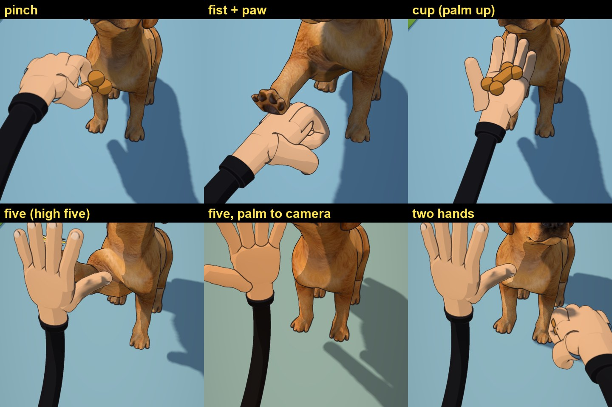

# Polished 3D cartoon hand (`hand3d.js`)

The trainer's hand for POV shots (first used in `example/dog-high-five`). It replaces the old blobby sphere-and-capsule hand.

- **One smooth swept tube per finger** along its jointed bone chain: an elliptical cross-section, knuckle bulges, a rounded tip
  and a nail. There are no seams between segments, so the ink pass draws clean finger creases.
- **Palm:** a squared-off, tapered superellipsoid with thenar fullness that **cups** as the hand closes.
- **Thumb:** absolute per-segment directions, plus a 2-bone IK so the `pinch` tip really meets the index tip.
- A short wrist ending in a **slim black cuff**, where the trainer's black stick arm plugs in.
- A soft **3-tone toon ramp** on the skin (`soft: true`), and skin `#f2c4a0` to match the 2D trainer.
- **Blends happen on joint positions**, so `{ a: 'fist', b: 'five', k }` opens smoothly (IK thumb included).



## Use

Most videos never call it directly. `characters/pointers-3d/pointers3d.js` builds two of them (right = `W.hand`,
left = `W.hand2`) and places them for you:

```js
W.hand2 = { at: [x, y, z], pose: 'fist', grip: 'back', face: NOSE() };                 // fist the dog paws at (paw lands on `at`)
W.hand2 = { at: palm, pose: { a: 'fist', b: 'five', k }, mode: 'up', face: pawPoint }; // upright fist opening to a high-five palm
W.hand  = { at: treat, pose: 'pinch' };                                                // biscuit pinched at `at`
W.hand2 = { at, pose: 'cup', mode: 'tray', face: dogNose };                            // palm up, offering the treat
W.hand2 = { at, pose: 'five', mode: 'up', palm: dirToCamera, fingers: [0, 1, 0] };     // show the empty palm to the camera
```

`mode`: `reach` (fingers continue the arm, back of the hand up), `up` (fingers up, palm faces `face`), or `tray` (palm up).
Each preset has a default mode. `grip` picks which hand point lands on `at`: `pinch`, `fist` (inside the curl), `back` (top of
the fist, where a paw lands), `palm`, `cup` or `knuckles`. Also: `roll`, `tilt`, `side` (arm base), `sag`, and explicit `palm` / `fingers` world directions.

Direct use:

```js
import { makeHand, orientHand, HAND_POSES } from './hand3d.js';
const h = makeHand(THREE, { toon, mirror: false });   // mirror: true = left hand
scene.add(h.group); h.setPose('five');
orientHand(THREE, h, { at, palm: [-1, 0, 0], fingers: [0, 1, 0], grip: h.grip('palm'), scale: 1.25 });
```

Presets (`HAND_POSES`): `open five relax cup fist pinch point thumb`. Each finger is `[splay, mcp, pip, dip]`. The thumb is
`[[yaw, pitch] x 3, nailRoll]`, plus `thumbTo: 'index'` for the IK pinch. Add new poses there.

## Files

| File | What it is |
|---|---|
| `hand3d.js` | The hand (`makeHand`, `orientHand`, `HAND_POSES`, `resolvePose`) |
| `models/hand-{right,left}-{pose}.glb` | Every preset baked to glTF (standard material, metres, wrist at the origin, fingers +y, back of the hand +z) with a `grip` node. Use these outside this engine (Blender, other three.js apps) |
| `preview.jpg` | In-engine look (ink pass on), from the high-five video |
| `handtest.html` | Pose sheet: copy it into a project's `web/` and run `node snap.mjs "handtest.html?poses=fist,five" out.png` |
| `handexport.html` + `export_hands.mjs` | Re-bake the GLBs after editing the poses. Copy both into a project (the page into `web/`, which needs `lib/jsm/GLTFExporter.js` from three r160 with `'three'` imports pointed at `'../three.module.js'`), then run `node export_hands.mjs ../../characters/hand-3d/models` |

Projects get a copy through `tools/add-puppy3d.sh` and the project `build.sh` (next to `pointers3d.js`).
